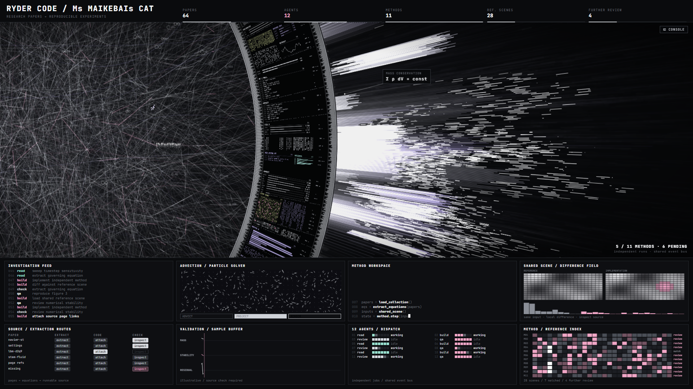

# HALOFLUX

> RYDER CODE / Ms MAIKEBAIs CAT

**English** | [中文](#中文说明)

A full-screen, beat-driven sci-fi data visualization — a woven light-field core, a rotating ring of micro data panels, and layered beams bursting outward. Pure native Canvas, single HTML file, zero dependencies.

> **Noncommercial use only. Any commercial use is strictly prohibited.** Free for personal study, hobby projects and private entertainment. See [License](#license).

## Files

| File | Description |
|---|---|
| `lab.html` | Desktop console edition (best at 16:9 full screen) |
| `mobile.html` | Mobile-compatible edition (portrait/landscape adaptive, lighter particle load) |
| `index.html` | Entry page: opens `mobile.html` on touch devices, `lab.html` otherwise |
| `audio/sw421k.mp3` | Background music (see Credits) |
| `wallpaper/` | Wallpaper Engine / Lively Wallpaper edition (see below) |

Showcase video: https://b23.tv/mBUoC3r

Steam Workshop (Wallpaper Engine): search *HALOFLUX* — listing coming soon.

## Usage

- Just open the HTML file in Edge / Chrome / Safari.
- **Double-click** or press **F** — toggle full screen.
- Click **CONSOLE** (top-right) or press **C** — open the live tuning panel (56 parameters: beat tempo, ring speed, beam layers, glow, depth...).
- **Export / Import** settings as JSON. **Save as default** stores your tweak in the local browser.
- URL `?preset=a` / `?preset=b` switches to the built-in A (dark) / B (bright) presets.
- **Background music** is on by default. Browsers block sound until the first interaction, so the BGM button shows *CLICK / TAP TO PLAY* — any click, tap or key starts it. Toggle with the **BGM** button or **M**, set the volume with its slider (remembered per browser). On iPhone, music plays even with the silent switch on (iOS 17+).

Everyone who opens the page gets the baked-in default look ("我的默认").

## Highlights

- Uneven beat clock drives everything — nothing moves at constant speed.
- Ring rotates with stutter-stops, sprints and drifts; 12 kinds of pre-rendered micro data blocks.
- 5 stacked outer beam layers (far / mid / main / near / bounce wave), roots always attached to the ring.
- Auto camera with push-ins across 7 shots.

## Desktop wallpaper

The `wallpaper/` folder is a ready-to-use **Wallpaper Engine** web wallpaper (`project.json` + `index.html`). No mouse UI, works offline, pauses (visuals and music) when a fullscreen app covers it.

- **Wallpaper Engine**: search *HALOFLUX* on the Steam Workshop (listing coming soon), or open the editor → *Create Wallpaper* → drop `wallpaper/index.html` in.
- **Lively Wallpaper** (free): *Add wallpaper* → URL `https://ryder191.github.io/haloflux/wallpaper/`.
- Settings: visual preset, tempo, ring speed (both default to a calm 0.6), auto camera on/off and camera intensity, glow, beam glow, scanlines, UI panels on/off (off = halo only), music on/off and volume.

## Credits

Music: **"Synthwave 421k"** by The Cynic Project (cynicmusic), from the *Pixelsphere* soundtrack — released under **CC0** on [OpenGameArt](https://opengameart.org/users/cynicmusic).

## License

**Copyright (c) 2026 Ryder191 (RYDER CODE / Ms MAIKEBAIs CAT). All rights reserved.**

HALOFLUX — its source code and its audiovisual design (composition, motion design, beat-driven timing, layered beam system, ring and panel graphics, color treatment, layout and overall look and feel) — is an original work protected by copyright.

Licensed under the [PolyForm Noncommercial License 1.0.0](LICENSE):

- ✅ **Free for noncommercial use**: personal study, hobby projects, private entertainment, research and teaching. You may use, modify and share it.
- ❌ **Commercial use is strictly prohibited**, including use inside or on behalf of a company, integration into commercial products or services, client / paid work, selling the software or its outputs and derivatives (paid wallpapers, templates, assets, videos), and commercial advertising. No commercial licenses are offered.
- When sharing or remixing, keep the copyright notice and credit **"HALOFLUX by Ryder191 (RYDER CODE / Ms MAIKEBAIs CAT)"** with a link to this repository.

Versions published before 2026-10-26 were released under MIT; from 2026-10-26 on, this project is licensed only under the terms above. The bundled music (`audio/sw421k.mp3`) is CC0 by its author and is not covered by this license.

---

## 中文说明

一个全屏、节拍驱动的科幻数据可视化：中心是编织状的光场核心，外面是一圈由微型数据面板组成的旋转圆环，环外有多层向外迸发的光束。纯原生 Canvas，单个 HTML 文件，零依赖。

> **仅限非商业用途，严格禁止任何商业用途。** 个人学习、兴趣项目、个人娱乐可免费使用。详见[许可证](#许可证)。

### 文件

| 文件 | 说明 |
|---|---|
| `lab.html` | 桌面控制台版（16:9 全屏效果最佳） |
| `mobile.html` | 移动端兼容版（横竖屏自适应，粒子负载更轻） |
| `index.html` | 入口页：触屏设备自动打开 `mobile.html`，其他设备打开 `lab.html` |
| `audio/sw421k.mp3` | 背景音乐（见「致谢」） |
| `wallpaper/` | 动态壁纸版（Wallpaper Engine / Lively Wallpaper，见下文） |

演示视频：https://b23.tv/mBUoC3r

Steam 创意工坊（Wallpaper Engine 壁纸）：搜索 *HALOFLUX*，即将上架。

### 使用方法

- 用 Edge / Chrome / Safari 直接打开 HTML 文件即可。
- **双击**画面或按 **F** 键：切换全屏。
- 点击右上角 **CONSOLE** 或按 **C** 键：打开实时调参面板（56 个参数：节拍速度、圆环转速、光束层、辉光、景深……）。
- 设置可**导出 / 导入**为 JSON；点击**保存为默认**，会把当前调整保存在本机浏览器中。
- 在网址后加 `?preset=a` / `?preset=b`，可切换到内置的 A（暗底）/ B（亮线）预设。
- **背景音乐**默认开启。浏览器在用户首次交互前会禁止播放声音，所以 BGM 按钮会显示 *CLICK / TAP TO PLAY*，任意点击、轻触或按键即可开始播放。点击 **BGM** 按钮或按 **M** 键开关音乐，用旁边的滑块调节音量（每个浏览器会记住各自的设置）。在 iPhone 上，即使打开了静音开关也能播放音乐（iOS 17 及以上）。

所有打开页面的人看到的都是内置的默认外观（「我的默认」）。

### 亮点

- 不均匀的节拍时钟驱动一切，没有任何东西是匀速运动的。
- 圆环转动带有卡顿急停、快速冲刺和缓慢漂移；内含 12 种预渲染的微型数据块。
- 环外光束共 5 层叠加（远景 / 中景 / 主层 / 近景 / 回弹波浪），光束根部始终连着圆环。
- 自动运镜，7 个镜头间带推近效果。

### 桌面动态壁纸

`wallpaper/` 目录就是一个可以直接使用的 **Wallpaper Engine** 网页壁纸（`project.json` + `index.html`）：没有鼠标界面、离线可用，被全屏程序遮挡时画面和音乐都会自动暂停。

- **Wallpaper Engine**：在 Steam 创意工坊搜索 *HALOFLUX*（即将上架）；也可以打开壁纸编辑器 → 创建壁纸 → 把 `wallpaper/index.html` 拖进去。
- **Lively Wallpaper**（免费）：添加壁纸 → 输入网址 `https://ryder191.github.io/haloflux/wallpaper/`。
- 可调设置：视觉预设、节拍速度、圆环转速（两者默认都是舒缓的 0.6）、自动运镜开关和运镜幅度、柔光、光束辉光、扫描线、界面面板开关（关闭后只留光环）、背景音乐开关和音量。

### 致谢

音乐：The Cynic Project（cynicmusic）的 **"Synthwave 421k"**，出自 *Pixelsphere* 原声，以 **CC0** 协议发布于 [OpenGameArt](https://opengameart.org/users/cynicmusic)。

### 许可证

**Copyright (c) 2026 Ryder191（RYDER CODE / Ms MAIKEBAIs CAT），保留所有权利。**

HALOFLUX 的源代码及其视听设计（画面构图、动态设计、节拍驱动的动画节奏、多层光束系统、圆环与数据面板图形、配色处理、界面布局及整体视觉风格）均为原创作品，受著作权法保护。

按 [PolyForm Noncommercial License 1.0.0](LICENSE) 授权：

- ✅ **非商业用途免费**：个人学习、兴趣项目、个人娱乐、研究与教学，可以使用、修改和分享。
- ❌ **严格禁止任何商业用途**，包括但不限于：在公司内部或代表公司使用、集成到商业产品或服务、接单或有偿项目、出售本软件及其生成内容和衍生作品（付费壁纸、模板、素材、视频），以及商业广告推广。不提供商业授权。
- 转载或二次创作时，必须保留版权声明，并注明 **「HALOFLUX by Ryder191（RYDER CODE / Ms MAIKEBAIs CAT）」** 及本仓库链接。

2026-10-26 之前发布的版本曾以 MIT 协议发布；自 2026-10-26 起，本项目仅按上述条款授权。附带的音乐（`audio/sw421k.mp3`）由原作者以 CC0 发布，不受本协议约束。
